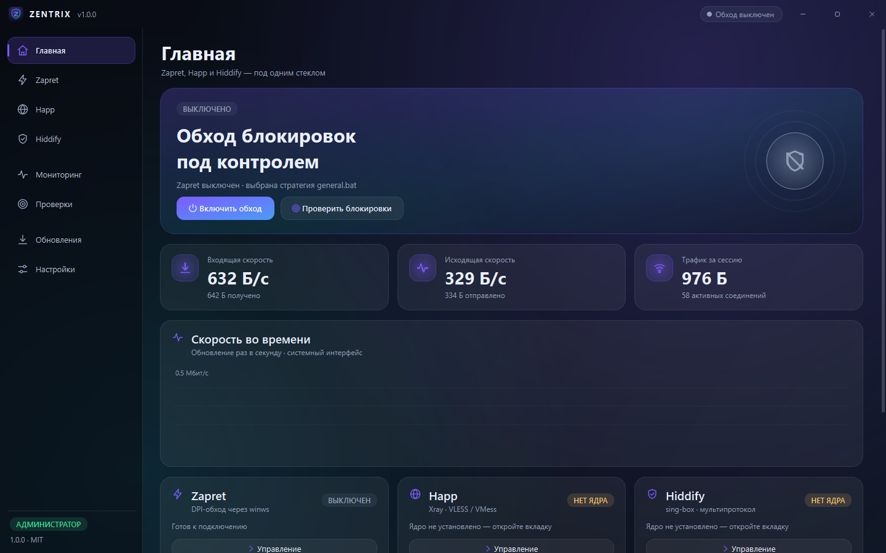
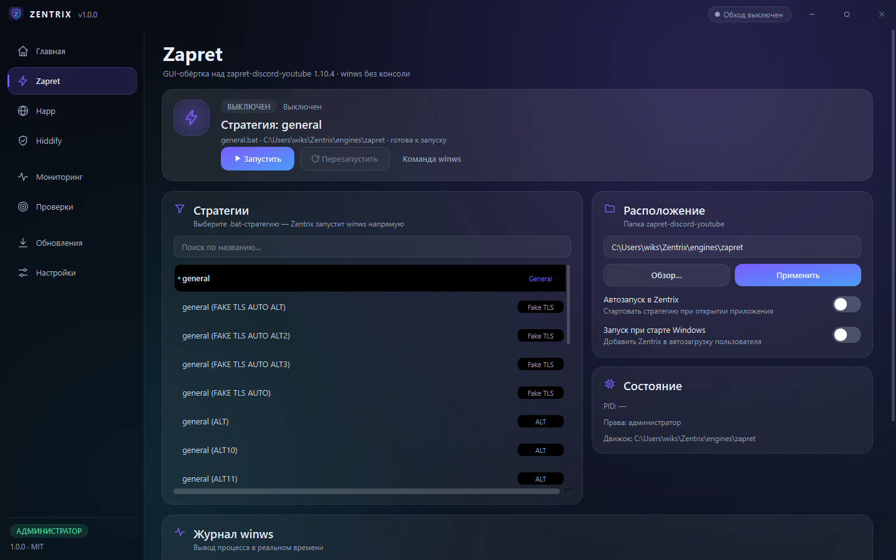
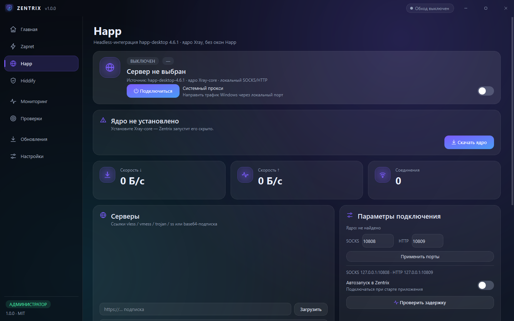
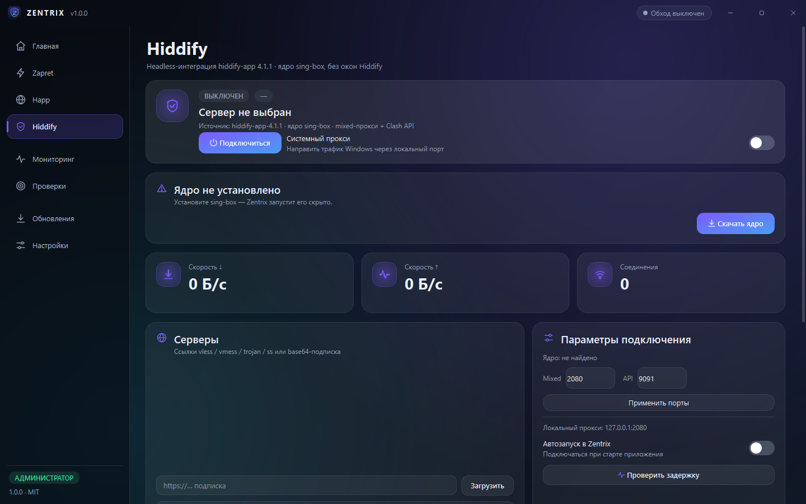
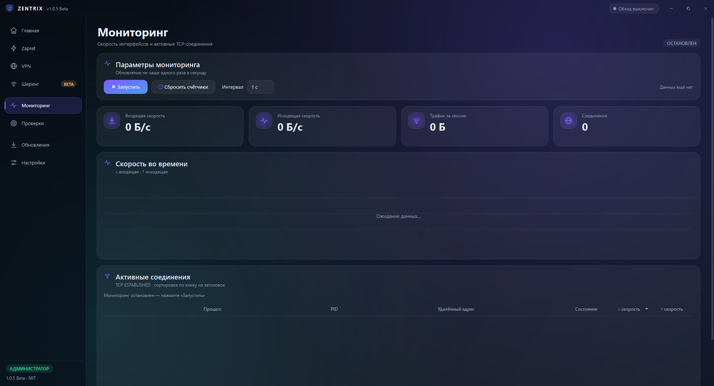
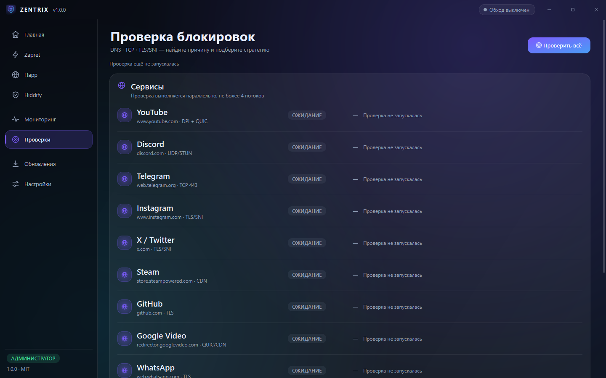
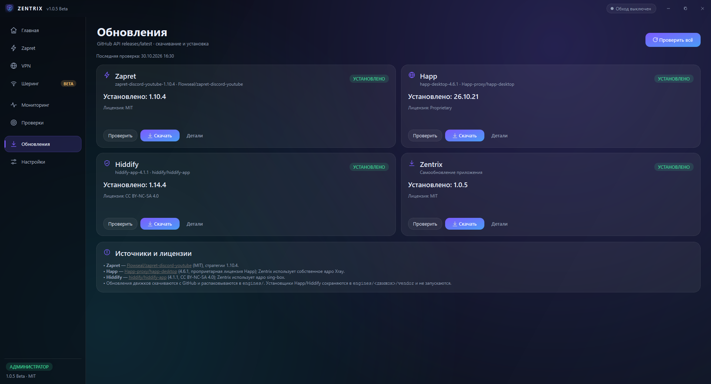
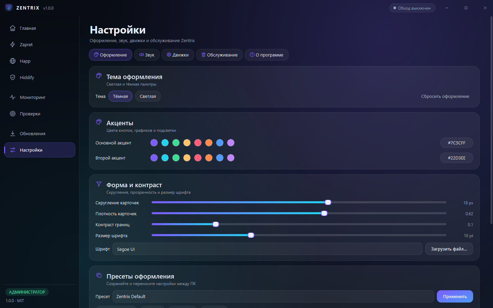
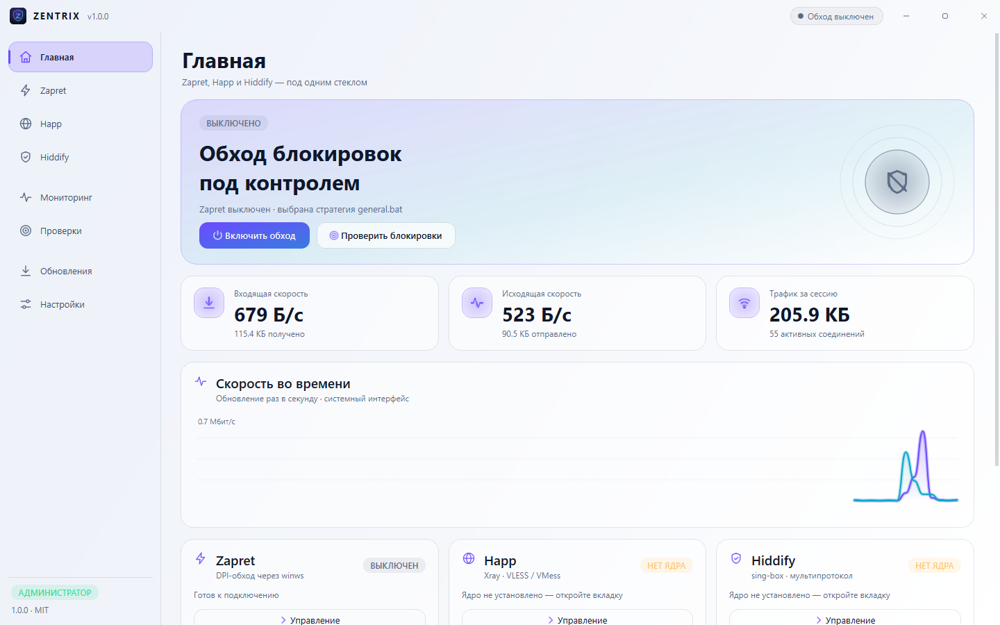

<div align="center">


# Zentrix

**Одно окно для Zapret, Happ и Hiddify.**
Обход блокировок, прокси, мониторинг и проверки — в аккуратном нативном интерфейсе Windows.


<br>

<a href="https://w1kscc.github.io/Zentrix/"></a> &nbsp;
<a href="https://w1kscc.github.io/Zentrix/#download"></a> &nbsp;
<a href="https://github.com/w1kscc/Zentrix/releases"></a>

</div>

---

Zentrix — это графическая оболочка, которая собирает три популярных инструмента
обхода блокировок в одном окне. Никаких чёрных консолей, отдельных окон Happ или
Hiddify и запутанных `.bat`-файлов: все процессы работают скрыто, а управление
идёт из единого интерфейса.

> **Сайт проекта:** <https://w1kscc.github.io/Zentrix/> — скриншоты,
> установщик и портативная сборка в один клик.

## Возможности

- **Одно окно, без консолей.** Zapret запускается напрямую через `winws.exe`,
  Happ — через headless-ядро Xray, Hiddify — через headless-ядро sing-box.
  Дочерние процессы создаются с `CREATE_NO_WINDOW`.
- **Zapret.** Автоматически находит стратегии в `.bat`-файлах, разворачивает
  переменные и запускает `bin\winws.exe` без `cmd.exe` и `start`. 22 стратегии,
  игровой фильтр, свои списки доменов, живой лог, проверка выбранной стратегии
  и автоматический поиск лучшей стратегии с опросом доступности сервисов.
- **Happ и Hiddify.** Вставьте `vless://`, `vmess://`, `trojan://` или `ss://` —
  Zentrix разберёт ссылку, сгенерирует конфиг и поднимет локальный SOCKS/HTTP
  прокси. Ядра Xray-core и sing-box скачиваются по требованию.
- **Мониторинг.** Скорость, графики, активные TCP-соединения и процессы,
  которые держат сеть. Мониторинг запускается вручную и останавливается при
  уходе со страницы — без фоновой нагрузки.
- **Проверки блокировок.** DNS против DoH, TCP-доступность и классификация TLS
  SNI для YouTube, Discord, Telegram, Instagram, X, Steam, GitHub и других
  сервисов. Понятный отчёт: что работает, что заблокировано и чем.
- **Обновления.** Проверка релизов Zapret, Happ, Hiddify и самого Zentrix через
  GitHub API. Обновление Zapret сохраняет ваши `lists/` и настройку игрового
  фильтра.
- **Очистка.** Безопасный предпросмотр временных файлов, кэшей и логов с
  оценкой освобождаемого места. Необязательный автозапуск при старте.
- **Внешний вид.** Тёмная и светлая темы, пресеты оформления, акцентные цвета,
  скругления, видео-фон (MP4/WebM/MOV/MKV, по желанию), 35 векторных иконок и
  полностью кастомный title bar.
- **Звуки без аудиофайлов.** Все сигналы синтезируются на лету (синус/треугольник,
  ADSR-огибающая) и кэшируются как WAV.
- **Трей, автозапуск, единственный экземпляр.** Закрытие в трей, запуск
  свёрнутым, `%APPDATA%\Zentrix` для настроек и логов.
- **Быстрый старт.** Ленивая загрузка страниц, тяжёлая работа в фоновых
  потоках, целевое время холодного старта — до 1,5 секунды.

## Скриншоты

| Главная | Zapret | Happ |
|:---:|:---:|:---:|
|  |  |  |

| Hiddify | Мониторинг | Проверки |
|:---:|:---:|:---:|
|  |  |  |

| Обновления | Настройки · оформление | Светлая тема |
|:---:|:---:|:---:|
|  |  |  |

## Установка

### Готовый установщик

1. Скачайте `ZentrixSetup.exe` из раздела **Releases**.
2. Запустите установщик. Установка **для текущего пользователя**, права
   администратора не нужны.
3. При первом запуске откроется главная страница. Для Zapret может потребоваться
   повышение прав — используйте кнопку **«Перезапустить от администратора»** в
   настройках (драйвер WinDivert).
4. Happ и Hiddify работают в локальном прокси-режиме и не требуют прав
   администратора. Системный прокси включается переключателем на их страницах.

Установщик кладёт приложение в `%LOCALAPPDATA%\Programs\Zentrix`, настройки — в
`%APPDATA%\Zentrix`. При удалении пользовательские настройки и профили
сохраняются.

### Из исходников

```powershell
git clone https://github.com/w1kscc/Zentrix.git
cd zentrix
py -3.12 -m venv .venv
.\.venv\Scripts\Activate.ps1
python -m pip install -r requirements.txt
python scripts/fetch_engines.py --zapret
python -m src.main
```

Требования: Windows 10/11 x64, Python 3.12, ~250 МБ свободного места (с ядрами).

## Движки и локальные пути

Движки **не хранятся в репозитории** и не попадают в git. Они скачиваются
скриптом или через страницу «Обновления»:

```
engines/
  zapret/                 # zapret-discord-youtube 1.10.4
    bin/winws.exe
    general.bat, general (ALT).bat, ...
    lists/
  xray/core/xray.exe      # ядро для интеграции Happ
  singbox/core/sing-box.exe
  happ/vendor/            # опционально: оригинальный установщик Happ
  hiddify/vendor/         # опционально: оригинальный установщик Hiddify
```

Загрузить всё необходимое:

```powershell
python scripts/fetch_engines.py --zapret      # Zapret 1.10.4
python scripts/fetch_engines.py --cores       # Xray-core + sing-box
python scripts/fetch_engines.py --all         # всё перечисленное
```

Абсолютные пути к локальным копиям движков можно задать в git-ignored файле
`settings.local.json` (пример — `settings.local.json.example`). В коде и
документации жёстких путей нет.

## Как устроен Zentrix

```
src/
  main.py                 # единственный экземпляр, окно, трей, пост-старт
  constants.py            # версии, источники, сервисы
  settings_store.py       # атомарные настройки JSON
  cleaner.py              # безопасная очистка
  netmon.py               # psutil + TCP-таблица Windows
  blocking_check.py       # DNS / DoH / TCP / TLS SNI
  updater.py              # GitHub-релизы и установка обновлений
  sound_generator.py      # процедурный синтез звуков
  engines/                # zapret, happ, hiddify, links, cores
  ui/
    main_window.py        # frameless-окно, ленивые страницы
    theme.py              # палитры и QSS
    widgets.py            # фон, карточки, иконки, тосты
    pages/                # 8 страниц
scripts/
  fetch_engines.py        # загрузка движков
  build.py                # PyInstaller + Inno Setup
  make_icons.py           # генерация SVG/PNG/ICO/ICNS
installer/
  zentrix.iss             # Inno Setup (per-user)
tests/                    # pytest
docs/                     # архитектура, сборка, troubleshooting, скриншоты
```

Подробности: [docs/ARCHITECTURE.md](docs/ARCHITECTURE.md),
[docs/BUILD.md](docs/BUILD.md), [docs/TROUBLESHOOTING.md](docs/TROUBLESHOOTING.md).

### Почему нет отдельных окон

| Инструмент | Что делает Zentrix | Чего не происходит |
|---|---|---|
| Zapret | Парсит `.bat`, подставляет `%BIN%`, `%LISTS%` и запускает `winws.exe` | Не открывается `cmd.exe`, не мигает консоль |
| Happ | Генерирует конфиг Xray и запускает `xray.exe` | Не запускается GUI Happ |
| Hiddify | Генерирует конфиг sing-box и запускает `sing-box.exe` | Не запускается GUI Hiddify |

Логи движков читаются из stdout/stderr и показываются внутри Zentrix. При
выходе все дочерние процессы завершаются, а системный прокси сбрасывается.

## Тесты и сборка

```powershell
python -m pytest -q
python scripts/build.py                  # portable + installer
python scripts/build.py --skip-installer # только dist/Zentrix
```

Результат:

```
dist/Zentrix/Zentrix.exe          # portable
dist/installer/ZentrixSetup.exe   # установщик Inno Setup
```

Для сборки установщика нужен [Inno Setup 6](https://jrsoftware.org/isinfo.php).
CI (`.github/workflows/build.yml`) собирает portable и установщик на
`windows-latest` и прикладывает артефакты к запуску.

## Третьи стороны

Zentrix — независимый проект. Он не аффилирован с авторами перечисленных
инструментов. Каждый компонент распространяется по своей лицензии:

| Компонент | Версия | Лицензия | Источник |
|---|---|---|---|
| **zapret-discord-youtube-1.10.4** | 1.10.4 | MIT | [Flowseal/zapret-discord-youtube](https://github.com/Flowseal/zapret-discord-youtube) · [LICENSE](https://github.com/Flowseal/zapret-discord-youtube/blob/main/LICENSE.txt) |
| **happ-desktop-4.6.1** | 4.6.1 | Proprietary (Happ) | [Happ-proxy/happ-desktop](https://github.com/Happ-proxy/happ-desktop) |
| **hiddify-app-4.1.1** | 4.1.1 | CC BY-NC-SA 4.0 | [hiddify/hiddify-app](https://github.com/hiddify/hiddify-app) · [LICENSE](https://github.com/hiddify/hiddify-app/blob/main/LICENSE.md) |
| Xray-core | актуальная | MPL-2.0 | [XTLS/Xray-core](https://github.com/XTLS/Xray-core) |
| sing-box | актуальная | GPL-3.0 | [SagerNet/sing-box](https://github.com/SagerNet/sing-box) |
| Qt / PySide6 | 6.12.0 | LGPL-3.0 / GPL-3.0 / commercial | [qt.io](https://www.qt.io/qt-6/lgpl) |
| psutil | 7.2.2 | BSD-3-Clause | [giampaolo/psutil](https://github.com/giampaolo/psutil) |
| Inno Setup | 6.x | Inno Setup License | [jrsoftware.org](https://jrsoftware.org/isinfo.php) |

Zentrix не перераспространяет установщики Happ и Hiddify: приложение скачивает
ядра с официальных GitHub-релизов по запросу пользователя. Условия
использования Happ и Hiddify определяются их авторами; коммерческое
использование Hiddify ограничено лицензией CC BY-NC-SA 4.0.

## Безопасность и приватность

- Настройки, логи и профили хранятся только локально в `%APPDATA%\Zentrix`.
- Приложение не отправляет телеметрию. Сеть используется для проверки
  обновлений, загрузки ядер и проверок доступности сервисов.
- Очистка работает только с известными временными каталогами и кэшем Zentrix;
  перед удалением показывается предпросмотр.
- Для работы Zapret требуются права администратора (WinDivert). Happ/Hiddify
  могут работать без них в режиме локального прокси.

## Ограничения

- Только Windows 10/11 x64. macOS/Linux не поддерживаются.
- Эффективность обхода зависит от провайдера, региона и выбранной стратегии.
- Проект предоставляется «как есть», без гарантий. Соблюдайте законодательство
  своей страны и условия использования сервисов.

## Лицензия

Код Zentrix распространяется по лицензии **MIT** — см. [LICENSE](LICENSE).
Сторонние движки и библиотеки сохраняют свои лицензии (таблица выше).
